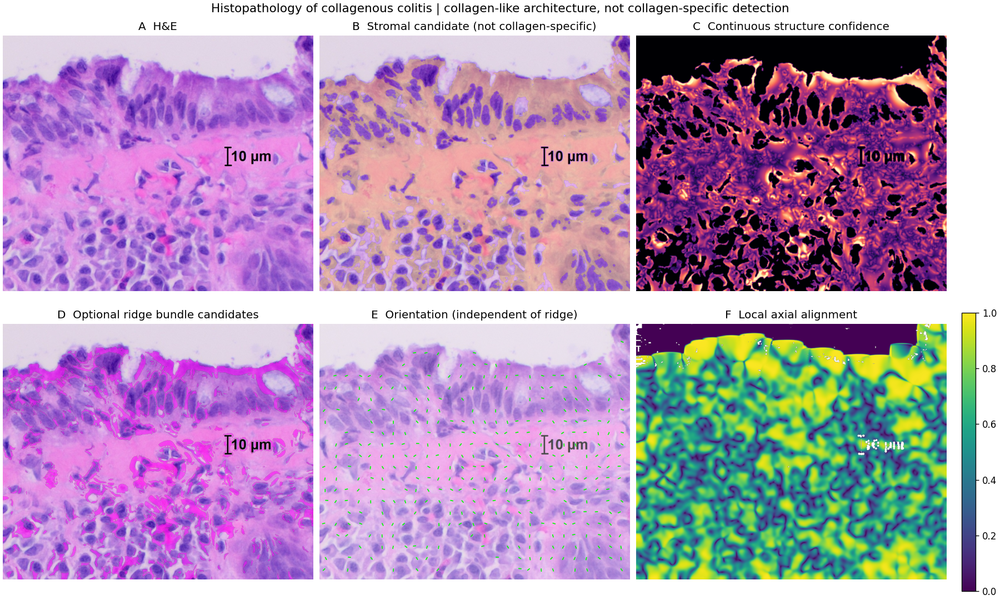
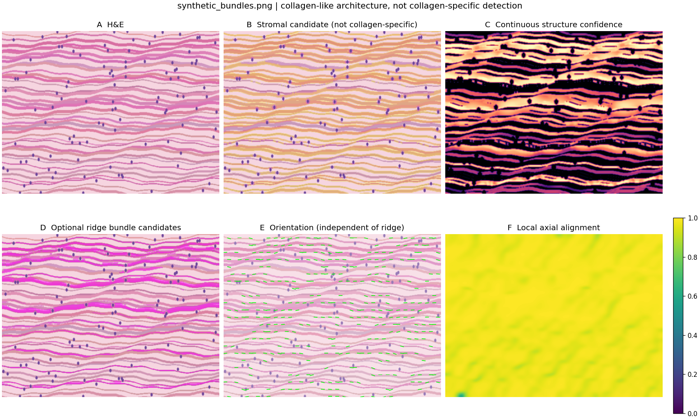

# CACHE

**Canonical Analysis of Collagen in Hematoxylin and Eosin Slide Images**

CACHE is a **training-free, unsupervised Python research prototype** for quantifying *collagen-like stromal architecture* in H&E histology. It combines a continuous multiscale orientation/structure-tensor branch with an **independent** ridge-based branch for optional bundle candidates. No pretrained model, annotations, or GPU are required.

> **Scientific scope:** CACHE does **not** establish collagen-specific detection. Eosinophilic smooth muscle, cytoplasm, and artifacts can confound measurements. Results are not clinical diagnoses. Image-level orientation coverage is not collagen sensitivity, and without verified micrometers-per-pixel (MPP), geometric measurements are in pixel units only.

## Quick start

```bash
python -m pip install -e '.[demo,test]'
python examples/generate_synthetic.py
cache-he examples/synthetic_bundles.png --output cache_output/synthetic
pytest -q
```

For a verified-resolution image:

```bash
cache-he path/to/he_crop.png --mpp 0.25 --scales 1.5 3 6 12 --window 30 --output cache_output/he_crop
```

The command writes `review.png` (six panels), `features.json`, masks (`candidate.png`, `structure_valid.png`, `bundles.png`), and `architecture_maps.npz` (orientation, coherency, alignment, confidence, ridge score).

### Python API

```python
from PIL import Image
import numpy as np
from cache import analyze, plot_review

rgb = np.asarray(Image.open('examples/synthetic_bundles.png').convert('RGB'))
r = analyze(rgb, mpp=None, scales_um=(1.5, 3, 6, 12), window_um=30)
print(r['features'])
plot_review(r, 'cache_output/review.png', title='Synthetic example')
```

## Example CACHE results — real H&E

The example below uses the **histopathology of collagenous colitis** image supplied with the demonstration dataset. The six panels show (A) H&E, (B) eosin-rich stromal candidates, (C) continuous structure confidence, (D) optional ridge candidates, (E) orientation vectors, and (F) local axial alignment. **These are collagen-like architectural measurements, not validated collagen segmentation.**



*Real-world CACHE demonstration: collagenous colitis.* Qualitative review is necessary: epithelial and inflammatory regions may be detected, and the presence of strong directional texture does not prove collagen specificity. The image was supplied by the user; its publicly listed source is [Wikimedia Commons](https://commons.wikimedia.org/wiki/File:Histopathology_of_collagenous_colitis.jpg). Check source-specific attribution and redistribution terms before publishing the repository. The original image's MPP was not verified; measurements here are pixel-based.

To reproduce this figure from the repository root:

```bash
cache-he "examples/real_images/Histopathology of collagenous colitis.jpg" --output cache_output/real_colitis
```

### Synthetic example

The separate synthetic demonstration remains available in the [Jupyter notebook](notebooks/CACHE_demo.ipynb), which contains **one section for synthetic images and another for real H&E images**. Synthetic geometry helps test orientation recovery but does not validate real-tissue collagen specificity.



Run the synthetic example with:

```bash
python examples/generate_synthetic.py
cache-he examples/synthetic_bundles.png --output cache_output/synthetic
```

## How it works

1. RGB to H&E optical-density representation; heuristic tissue and annotation rejection.
2. Eosin-rich nonnuclear candidate pixels (not collagen-specific).
3. **Continuous branch:** multiscale gradient structure tensors, axial orientations (180° periodic), coherency, structure confidence, local weighted axial alignment.
4. **Optional ridge branch:** multiscale Sato filtering and candidate bundle mask, **not used as a gate** for continuous orientation.
5. Six-panel review plot and quantitative summaries.

The continuous branch addresses a failure mode of ridge-only analysis on broad, densely interwoven collagen-like structures. No claim of validated collagen segmentation is made.

## Interpreting the output

- `candidate_fraction`: fraction of image pixels meeting an eosin-rich, nonnuclear appearance heuristic (not collagen fraction).
- `orientation_coverage`: proportion of candidates meeting structural thresholds (not recall).
- `ridge_coverage`: proportion of candidates selected as ridge-like (not specificity).
- `global_alignment`: axial resultant of valid orientation vectors (0 = mixed directions, 1 = aligned).
- `mean_local_alignment`: weighted local directional organization; may be high for noncollagen structures.

## Real H&E and image provenance

**This working repository includes the user-supplied real H&E examples for demonstration; verify redistribution licenses before making the repository public.** Public visibility does not imply permission to redistribute an image, and figures with embedded arrows/scale bars are unsuitable as clean benchmark inputs. For reproducibility, use original source images and record author, source URL, license, attribution, any modifications, and verified MPP. Add only files with verified redistribution rights. A source log template is provided in `examples/REAL_IMAGES.md`.

## Limitations and validation plan

- H&E alone cannot provide collagen molecular specificity.
- Stain decomposition and candidate masks are heuristic and may fail across laboratories.
- Artifacts, muscle, epithelial boundaries, and vessel walls require more robust exclusion.
- MPP metadata must be verified; screenshot-derived pixel scales are not valid.
- The synthetic generator tests behavior on simplified geometry, not real-tissue collagen sensitivity.
- Before publishing biological claims: assess artifact rejection, pathologist-reviewed overlays, perturbation stability, geometric simulation accuracy, and independent validation.

## Development status

**CACHE** is the repository and package name; this is the first public-facing prototype, so no historical v0.1/v0.2 nomenclature is required. Package version `0.1.0` is a software release identifier only.

## License

Code is MIT-licensed (see `LICENSE`). Third-party histology images, if later added, retain their own licenses.
